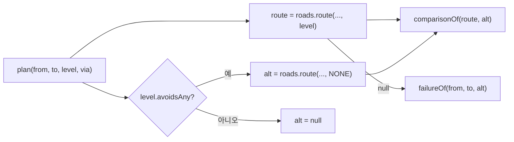

# 터널 회피 경로 탐색 (비용 모델)

이 문서는 `pleos-app/app/src/main/kotlin/kr/tunnelfree/app/domain/` 의 코드를 그대로 읽어 정리한 것입니다.
상수·규칙이 바뀌면 이 문서도 함께 고칩니다. 관련 파일: `RoadNetwork.kt`, `AvoidanceLevel.kt`, `RoutePolicy.kt`, `RoutePlanner.kt`, `RoadRoute.kt`, `Tunnel.kt`, `TunnelMonitor.kt`, 그리고 경로 계산을 부르는 `ui/TunnelFreeViewModel.kt` 의 `computeRoutes`.

## 1. 도로망 에셋

`assets/roads_daejeon.txt` (평문, `#` 주석). 형식은 `pleos-app/tools/build_roads.py` 를 보세요.

```
V n   lat_e6 lng_e6                                   정점(교차점·도로 끝)
P m   lat_e6 lng_e6                                   간선 중간 기하점 풀
E k   u v len_dm class oneway tunnel_m gstart gcount name
```

- `len_dm`: 간선 기하 길이(0.1 m 단위). `build_roads.py` 가 OSM way 의 점 사이 거리(등거리 근사)를 더해 만들고, `parse()` 가 `/ 10.0` 으로 `RoadEdge.lengthM` 을 만듭니다.
- `class`: `RoadClass` 코드 0~12 (모르는 코드는 `UNCLASSIFIED`). 각 등급에 가정 평균 속도 `speedKmh` 가 있습니다 (예: MOTORWAY 90, PRIMARY 55, RESIDENTIAL 30 km/h).
- `oneway`: `1` 이면 from→to 방향만 인접 리스트에 들어갑니다.
- `tunnel_m`: 0 이면 일반 도로. 0 보다 크면 이 간선이 속한 터널 전체 길이(끝점을 공유하고 이름이 충돌하지 않는 터널 way 를 이은 체인의 길이)입니다. 간선 자체 길이와 다를 수 있고, 회피 판정은 이 값으로 합니다.

## 2. 간선 비용 = 소요 시간

```kotlin
val travelSec: Double get() = lengthM / (roadClass.speedKmh / 3.6)
```

다익스트라 비용은 거리(m)가 아니라 초입니다. 같은 거리라도 큰 도로가 싸게 잡힙니다. 우선순위 큐에는 비용을 ms 단위 정수로 바꿔 정점 번호와 한 `Long` 에 묶어 넣습니다(`pack`).

## 3. 출발·도착 스냅 (다중 후보)

`snapCandidates(p)` 는 점 p 에서 반경 `SNAP_RADIUS_M = 400 m` 안의 정점을 가까운 순으로 최대 `SNAP_MAX_CANDIDATES = 12` 개 고릅니다. 반경 안에 하나도 없으면 가장 가까운 정점 하나를 씁니다.

`shortestPath(sources, targets, maxTunnelM)` 는 다중 출발·다중 도착 다익스트라입니다. `maxTunnelM` 은 지나도 되는 터널 길이 한도(m)입니다.

- 출발 후보 v 의 초기 비용 = `스냅 거리 / SNAP_SPEED_MPS` (`SNAP_SPEED_MPS = 20 km/h`).
- 도착 후보 v 에 닿으면 `dist[v] + 스냅 거리 / SNAP_SPEED_MPS` 를 총비용으로 보고 가장 작은 것을 고릅니다.
- 꺼낸 정점 비용이 지금까지 최선 총비용 이상이면 탐색을 멈춥니다.

스냅 거리를 저속 주행 시간으로 바꿔 더하므로 "가까운 정점"이 우선이지만, 가장 가까운 정점이 고립 구역(지하차도로만 이어진 곳 등)이면 옆 정점에서 경로가 나옵니다. 예: 400 m 떨어진 후보는 72초(400 / 5.56 m/s)의 비용을 안고 시작합니다. 스냅 비용은 탐색에만 쓰이고 `RoadRoute.travelSec` 에는 들어가지 않습니다.

## 4. 터널은 벌점이 아니라 제외

```kotlin
if (e.isTunnel && e.tunnelLengthM > maxTunnelM) continue
```

`tunnelLengthM` 이 한도 `maxTunnelM` 보다 긴 터널 간선은 그래프에 없는 것으로 봅니다. `route(from, to, level, via)` 는 한도로 `level.maxTunnelLengthM` 을 넘기지만, 앱은 `route(from, to, maxTunnelM, via)` 에 `RouteContext.effectiveLimitM` 을 넘깁니다. 아무리 돌아가도 회피 대상 터널은 지나지 않고, 우회로가 없으면 경로가 null 이 됩니다.

| 강도 | `maxTunnelLengthM` | 지나가는 터널 |
|---|---|---|
| `FULL` (기본) | 0 | 없음 |
| `SHORT_OK` | 300 | 300 m 이하 |
| `MEDIUM_OK` | 1000 | 1 km 이하 |
| `LONG_OK` | 3000 | 3 km 이하 |
| `NONE` | `Double.MAX_VALUE` | 전부 |

위 표는 시작값입니다. 앱이 실제로 쓰는 한도 `effectiveLimitM` 은 이 값에 통과 평가 조정(힘들었던 터널은 길이 × 0.7로 낮추고, 편했던 터널이 2번이면 길이 × 1.5로 높임), 오늘 상태 '힘듦' 또는 30분 안의 도움 요청(× 0.5), 야간(× 0.7)을 반영한 값입니다. `NONE` 은 조정 없이 한도가 없습니다.

## 5. 경유지 (두 구간)

`route(from, to, level, via)` 에 via 가 있으면:

1. 1구간: 출발 후보 → via 후보 (다중 스냅).
2. 2구간: 1구간이 실제로 도착한 via 정점 하나(비용 0) → 도착 후보.

두 구간 모두 같은 터널 길이 한도(`maxTunnelM`)를 씁니다. 어느 한 구간이라도 없으면 전체가 null 입니다. `assemble()` 은 두 구간을 이어 하나의 폴리라인으로 만들고, 구간 경계의 누적 거리를 `RoadRoute.viaM` 으로 남깁니다.

## 6. 경로 조립 (`assemble`)

- 간선 기하점을 이어 폴리라인을 만들고 누적 거리 `cumulativeM` 은 점 사이 `distanceMeters` 로 다시 잽니다 (그래서 `lengthM` 은 간선 `len_dm` 합과 소수점 정도 다를 수 있음).
- `travelSec` = 지나간 간선 `travelSec` 합. `minutes` = 올림(travelSec / 60).
- 터널 구간: 이름이 같고 바로 이어지는(간격 0.5 m 이내) 터널 간선은 `RouteTunnel` 하나로 합치고 길이는 `tunnelLengthM` 최댓값을 씁니다. 같은 간선을 되돌아오는 왕복은 별개 터널로 셉니다.
- 회전 안내: 교차로(정점에 닿는 간선 3개 이상)에서 앞뒤 20 m 방위 차이로 `TurnType` 을 정하고 직진은 뺍니다.

## 7. 회피 경로 + 비교 경로 (`computeRoutes`, `RoutePlanner`)

아래 그림은 `plan()` 의 흐름입니다. `plan()` 은 시험(`RoutePlannerTest`)에서만 쓰고, 앱은 같은 일을 `computeRoutes` 에서 합니다.



- 비교 경로: `comparisonOf(route, alt)` 는 `route == null` 이거나, 터널 수가 다르거나, 길이 차이가 `COMPARISON_MIN_DIFF_M = 1 m` 를 넘을 때 alt 를 돌려줍니다. 앱에서는 route 가 주 경로, alt 가 추천받지 못한 쪽입니다. 같은 경로면 비교 경로는 null.
- `RouteFailure` (위에서부터 판정):
  1. `TOO_CLOSE`: 출발·도착 직선거리 < `TOO_CLOSE_M = 100 m`.
  2. `AVOIDANCE_BLOCKS`: 터널 허용(alt) 경로는 있음 → 회피 강도 때문에 막힘.
  3. `UNREACHABLE`: 터널을 허용해도 경로 없음 (도로망 밖, 일방통행 등).
- 출발점(`RoutePlanner.origin`): GPS 가 도로망 경계 안이면 GPS, 아니면 시연 출발지.
- 앱은 `plan()` 을 부르지 않습니다. ViewModel 의 `computeRoutes` 가 `Dispatchers.Default` 에서 최단 경로(`NONE`)와 한도 `effectiveLimitM` 의 회피 경로를 구합니다. `RoutePolicy.decide` 가 추천한 쪽을 주 경로로 삼고, 다른 쪽은 `comparisonOf(주 경로, 다른 쪽)` 로 비교 경로가 됩니다. 주 경로가 없으면 `failureOf(from, to, 최단 경로)` 로 실패 이유를 정합니다.

## 8. 예제: 시험 도로망 (`RoadNetworkTest`)

```
  E(4)
  |
  C(1) ---- B(2) ---- F(5)    (B→F 일방통행)
  |      /  |
  |  터널   |
  A(0)      D(3)
```

모든 간선은 class 4 (PRIMARY, 55 km/h ≈ 15.28 m/s).

| 간선 | len_dm → lengthM | tunnel_m |
|---|---|---|
| A-B "시험터널" (대각선) | 10557 → 1055.7 m | 900 |
| A-C 북로 | 5566 → 556.6 m | 0 |
| C-B 동로 | 8970 → 897.0 m | 0 |
| B-D 남로 | 5566 → 556.6 m | 0 |
| C-E 북로 | 5566 → 556.6 m | 0 |
| B-F 일방로 (B에서 F로만) | 8970 → 897.0 m | 0 |

A→D 후보 경로 (정점끼리 556 m 이상 떨어져 있어 스냅 후보는 각각 정점 하나, 스냅 비용 0):

| 경로 | 간선 길이 합 | 비용 (간선 합 / 15.28 m/s) |
|---|---|---|
| A→B(터널)→D | 1612.3 m | 약 105.5 s |
| A→C→B→D | 2010.2 m | 약 131.6 s |

- 터널 판정은 간선 길이 1055.7 m 가 아니라 `tunnel_m = 900` 으로 합니다.
- `NONE`: 터널 경로가 더 싸서 선택. 테스트 단언: 터널 1개, 터널 길이 900, `lengthM ≈ 1612` (±30).
- `FULL`: 터널 간선 제외 → 우회. 테스트 단언: 터널 0개, C 를 지남, `lengthM ≈ 2010` (±30).
- `SHORT_OK`: 900 > 300 이라 제외 → 터널 0개. `MEDIUM_OK`: 900 ≤ 1000 이라 허용 → 터널 1개.
- 이 구간에서 `plan(..., FULL)` 을 부르면 비교 경로는 터널 수가 달라 NONE 경로가 됩니다 (테스트 `RoutePlannerTest.fullAvoidanceReturnsDetourAndTunnelComparison`).
- 일방통행: B→F 는 경로가 있고 F→B 는 `NONE` 에서도 null (테스트 `onewayIsRespected`).

## 9. 주행 중 터널 감시 (`TunnelMonitor`)

경로 탐색과 별개로, 실제 위치를 터널 DB(`assets/tunnels_daejeon.csv`)와 대조해 이벤트를 만듭니다.

- DB 전처리: 앱은 `TunnelDatabase.parse(...).mergeSegments()` 로 읽습니다. OSM 이 한 보어를 여러 way 로 나눈 경우, 이름이 같고(비어 있지 않음) 앞 출구와 뒤 입구가 `MERGE_GAP_M = 1 m` 미만이며 진행 방향 차이가 90° 미만이면 하나로 잇습니다 (앞 구간 id 유지, 길이 합산).
- 판정 순서 (`update(p)`, 이벤트 0~2개):
  1. 통과 중이면 중심선에서 `insideRadiusM × 2 = 60 m` 를 넘을 때 `Exited`.
  2. 중심선 `insideRadiusM = 30 m` 안의 가장 가까운 터널이면 `Entered`.
  3. 입구가 접근 반경 안이고 입구까지 거리가 줄어드는 중이면 터널마다 한 번 `Approaching`. 반경은 `approachRadiusFor(속도)` = max(500 m, 250 m + 속도(m/s) × 12초)이고, 속도를 모르면 500 m 입니다(시속 60 km 면 500 m, 시속 90 km 면 550 m). Pleos 빌드는 터널 입구 반경 300 m 근접 알림으로도 `Approaching` 을 받습니다.
- 쌍둥이 보어 규칙: 방금 나온 터널을 기억합니다. 다른 터널의 입구가 그 출구에서 `TWIN_ENTRY_M = 250 m` 미만이고 방향 차이가 `TWIN_MIN_TURN_DEG = 90°` 를 넘으면 반대 방향 보어로 보고 진입·접근을 내지 않습니다. 같은 id·같은 이름 구간도 접근 안내에서 뺍니다. 출구에서 `TWIN_SUPPRESS_M = 600 m` 넘게 멀어지면 억제를 풉니다.
- 경로 위 터널만: 경로 안내 중에는 ViewModel 이 `relevance` 를 `route.hasTunnelNear(t.entry) || route.hasTunnelNear(t.exit)` 로 바꿔, 지상 도로가 지하차도 위를 지날 때 오판하지 않게 합니다 (`hasTunnelNear` 기본값: 경로에서 60 m 이내, 터널 구간 앞뒤 150 m 이내).
