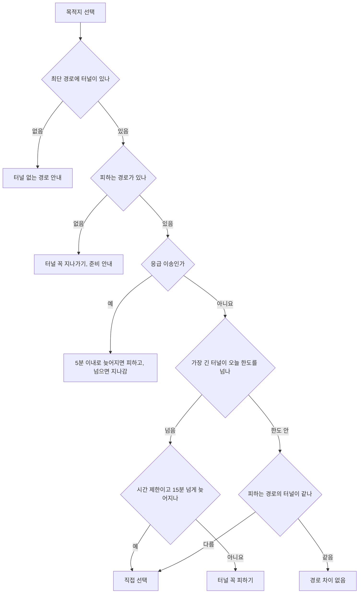
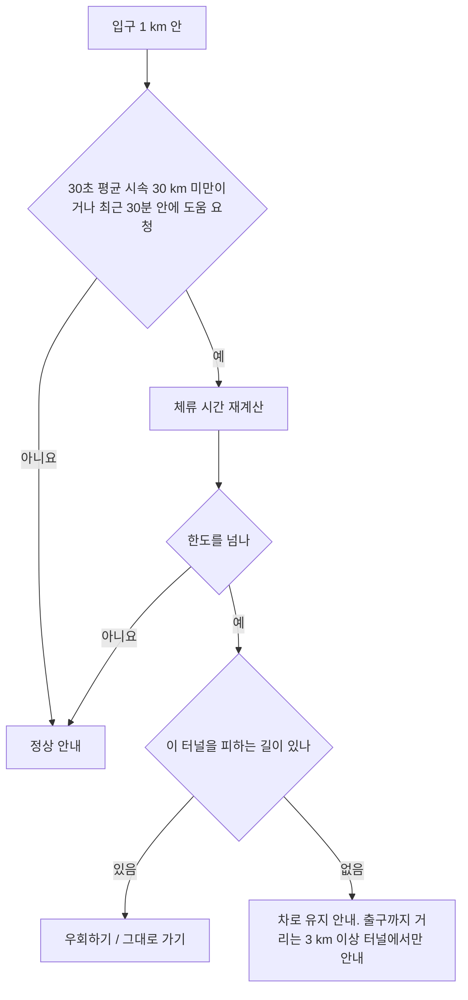

# 터널 통과 로직

공황장애나 폐소공포증이 있는 운전자가 터널을 지날 때 앱이 어떻게 판단하는지 적은 문서입니다. 팀 문헌 검토 보고서(`06_문헌검토보고서_터널통과불안`)를 바탕으로 썼고 2026년 11월 8일 내용까지 반영했습니다. 의료 조언이 아니고, 앱은 운전을 돕는 도구입니다.

아래의 "근거 N"은 보고서 부록 A의 A1~A28과 번호가 같습니다. 인용은 보고서에 적힌 그대로 옮겼습니다. 원문까지 직접 대조한 것은 근거 23(Kemp 2019)뿐입니다.

## 요약

처음에는 터널 길이로 판단했는데, 지금은 터널 안에 머무는 시간으로 판단합니다. 공황발작은 수 분 안에 가장 심해진다고 하니(근거 24), 같은 터널이라도 오래 갇혀 있을수록 힘들다고 본 것입니다. 나머지 원칙은 이렇습니다.

터널을 무조건 피하게 만들지 않습니다. 환자들은 터널을 피하기도 하지만 힘들어도 지나가거나 누군가와 함께 지나가기도 합니다(근거 20). 그래서 피하기, 준비하고 지나가기, 동행과 지나가기를 모두 열어 두었습니다. 다만 앱을 처음 켰을 때의 회피 강도는 안전한 쪽인 "모든 터널 회피"입니다.

정체가 생기면 짧은 터널도 안에 머무는 시간이 길어집니다. 앞뒤로 막힌 터널 안은 갇힌 느낌이 겹치는 상황이라(근거 7, 11) 입구 앞에서 실제 속도로 다시 계산합니다.

혼자일 때와 동승자가 있을 때의 한도는 따로 둡니다. 두 조건의 회피 정도는 중간 정도로만 상관이 있어서(근거 21) 동승자가 있다고 한도를 일정 비율로 올릴 근거가 없습니다.

안내는 몸의 반응이 시작되기 전에 합니다. 일반 운전자도 입구 250 m 앞부터 심박이 흔들리니까요(근거 17).

## 11월 8일 보고서로 바뀐 것

| 보고서 내용 | 처리 |
|---|---|
| 회피 기준 후보로 1 km와 3 km를 제시 | "3 km 이하 허용"(약 3분) 옵션 추가. 음성은 "긴 터널까지", "3킬로" |
| 안전 수단을 곁에 두기만 해도 학습이 방해될 수 있음(근거 23) | 설정 화면의 "익숙해지는 데 도움" 문구를 "치료를 대신하지 않습니다"로 교체 |
| 웨어러블 심박으로 공황 판별 가능성 | 넣지 않음. 웨어러블도 SDK 5종 밖이고, 교통 때문에 긴장한 것과 구분하는 방법이 검증되지 않음 |
| 운전 공포 56명 중 공황장애 진단은 14% | 발표 때 주의할 점에 추가 |

시속 60 km 계산, 혼자·동행 분리, 입구 앞 정체 재판단은 원래 로직과 같아서 그대로 두었습니다. 입구 안내 위치는 그 뒤에 속도에 따라 앞당기도록 바꿨습니다(아래 "터널 앞, 안, 출구").

## 어디까지 믿을 수 있나

| 규칙 | 근거 | 한계 |
|---|---|---|
| 터널을 불안 구간으로 본다 | 1~11, 27, 28 | 경향이지 모든 환자가 그렇다는 뜻은 아닙니다 |
| 체류 시간으로 판단한다 | 24, 26 | 공황 지속 시간 자료(25)는 비임상 표본의 자기 보고입니다 |
| 60초 미만은 짧은 터널 | 26 | 국내 터널 77.5%가 1 km 미만이라는 분포를 시간으로 옮긴 설계값입니다 |
| 180초 이상은 긴 터널 | 19, 24, 26 | 3 km 이상 98곳을 기준으로 한 설계값입니다 |
| 입구 앞에서 정체를 다시 본다 | 7, 11 | 정체 중 불안을 수치로 잰 연구는 없습니다 |
| 입구 250 m보다 앞에서 안내한다 | 17, 18 | 일반 운전자 연구입니다 |
| "입구에서 심장이 빨라지는 건 흔한 반응"이라고 알린다 | 12~17 | 이 문구의 효과를 시험한 연구는 없습니다 |
| 긴 터널은 출구 앞에서 알린다 | 17 | 일반 운전자 연구입니다 |
| 혼자·동행 한도를 나눈다 | 20, 21 | 동행의 효과가 얼마나 큰지는 모릅니다 |
| 음성 안내를 치료라고 하지 않는다 | 23 | 노출치료 연구를 앱에 옮겨 판단한 것입니다 |

## 체류 시간과 등급

체류 시간은 길이를 예상 속도로 나눈 값입니다. 출발 전에는 정체 정보가 없어서 시속 60 km로 계산합니다. 보고서의 두 속도 가운데 시간이 더 길게 나오는 쪽입니다.

| 등급 | 체류 시간 | 길이 | 국내 비율 | 기본 처리 |
|---|---|---|---|---|
| 짧음 | 60초 미만 | 1 km 미만 | 77.5% | 개인 한도에 맞으면 지나갑니다 |
| 중간 | 60~180초 | 1~3 km | 19.3% | 개인 한도로 판단합니다 |
| 긺 | 180초 이상 | 3 km 이상 | 3.2% | 개인 한도로 판단합니다. 지나가면 터널 안에서 60초마다 남은 거리를, 출구 300 m 앞에서 "곧 출구입니다"를 알립니다 |

지하차도 950곳은 97.8%가 1 km 미만이라 대부분 짧음에 들어가고, 따로 다루지 않습니다.

회피 강도를 시간으로 바꾸면 300 m는 18초, 1 km는 60초, 3 km는 180초입니다. 출발 전 판단에서는 미터로 보나 초로 보나 결과가 같고, 정체로 속도가 떨어질 때만 달라집니다.

## 출발 전 판단

꼭 지나가야 할 때는 가장 긴 터널의 이름, 등급, 예상 시간을 보여 줍니다. 입구 앞 15 km 안, 경로에서 500 m 안에 휴게소나 졸음쉼터가 있으면 들러 가는 버튼도 나옵니다.

오늘 한도는 회피 강도에서 시작해 이렇게 바뀝니다.

- "힘들었음"을 누르면 한도를 그 터널 길이의 70%로 바로 낮춥니다. 터널이 지금 한도의 1.5배보다 길거나 한도가 이미 더 낮으면 그대로 둡니다. 평가 대상은 이번 경로에서 가장 긴 터널입니다.
- 한도 이상인 터널에서 "괜찮음"이 두 번 쌓이면 그 길이의 1.5배로 올립니다. 연속일 필요는 없고, 중간에 "힘들었음"이 나오면 다시 셉니다.
- 오늘 상태가 "힘듦"이면 절반, 해가 진 뒤부터 뜰 때까지는 70%입니다.
- 도움 요청 화면을 열거나 "제가 불안해요"를 고른 뒤 30분 동안은 절반입니다. 힘듦과 겹쳐도 같은 몸 상태라 절반까지만 줄입니다.

평가 버튼은 괜찮음, 긴장됨, 힘들었음 세 개이고 내부 점수는 2, 5, 8입니다. 동승자가 있을 때 남긴 평가는 동행 기록으로 따로 저장합니다. 동행 한도는 혼자 한도에서 출발해 동행 평가로만 바뀌니, 동행 기록이 없으면 혼자 한도와 같습니다.

위 비율은 모두 우리가 정한 값입니다. 환자가 몇 분까지 버티는지 직접 잰 연구는 없습니다.

## 입구 앞에서 다시 판단

정체라면 그때의 평균 속도로 계산합니다. 시속 10 km면 1 km 터널도 6분입니다. 거의 멈춰 있어도 시속 5 km로 쳐서 계산이 끝나게 했습니다. 한 터널에는 한 번만 알립니다. 도움 요청으로 불안을 새로 알리면 같은 터널도 다시 확인합니다.

정체 판정에는 차량 속도만 씁니다. SDK에 앞쪽 도로의 실시간 정체 정보가 없어서 이미 정체에 들어선 뒤에야 알 수 있고, 출발 전 경로 판단에는 정체를 넣지 못했습니다. 모의 주행은 늘 시속 60 km로 달리므로 정체로 판정되지 않습니다.

## 터널 앞, 안, 출구

| 시점 | 안내 |
|---|---|
| 입구 500 m 앞, 시속 75 km를 넘으면 250 m + 속도×12초 | 이름, 길이, 예상 시간, "입구에서 심장이 빨라지는 건 흔한 반응입니다." |
| 진입 | "약 N초면 지나갑니다. 호흡에 집중하세요." |
| 긴 터널 안 | 60초마다 남은 거리, 출구 300 m 앞에서 "곧 출구입니다." |
| 출구 | "빠져나왔습니다. 잘 하셨습니다." 도전 모드면 오늘 통과 수 |
| 도착 후 | 괜찮음, 긴장됨, 힘들었음 평가. 운전 중에는 묻지 않습니다 |

터널 안에서 "제가 불안해요"를 누르면 출구까지 거리와 호흡을 안내하고, 멈추지 말고 출구까지 가도록 말합니다.

## 동승자와 음성 안내

음성 안내를 동행인 같은 역할이라고 설명할 수는 있습니다(근거 20). 다만 Kemp 등(2019)을 보면 안전 수단을 "필요하면 쓰라"고 곁에 두기만 한 조건이 지시대로 쓴 조건보다 공포 학습을 더 방해했습니다. 그래서 음성 안내와 음악을 치료라고 소개하지 않고, 운전 안전을 돕는 기능으로만 설명합니다.

## 쓰지 않은 근거

근거 27(터널 구간 심박으로 터널 공포군을 88% 구분)은 공모전 SDK에 심박 센서가 없어서 쓰지 않았습니다. 근거 22(MRI 조기 중단 6.6%)는 터널과 다른 상황이라 발표에서 비유로만 씁니다. 근거 6(입구가 블랙홀처럼 보임)은 앱이 바꿀 수 있는 부분이 아닙니다.

## 코드 위치

판단은 `domain/TunnelPassage.kt`(등급, 입구 앞 재판단, 긴 터널 안내, 쉼터 찾기)와 `domain/RoutePolicy.kt`(판정 순서, 오늘 한도, 혼자·동행 한도)에 있습니다. 테스트는 `TunnelPassageTest`, `RoutePolicyTest`, `GuidanceSpeechTest`입니다.

입구 안내(`TunnelMonitor`)는 500 m에서 시작해 시속 75 km를 넘으면 250 m + 속도×12초로 앞당기도록 바꿨습니다(`TunnelApproachRadiusTest`). 터널 안 정차 문구(`SafeStopGuide`)는 원래부터 근거와 맞아서 손대지 않았습니다.

아직 안 한 것도 있습니다. 동승자가 없을 때 동행 음성 안내를 권하는 기능, 도전 모드에서 안내를 줄여 가는 기능은 구현하지 않았습니다. 정체 재판단은 경로 안내 중에만 동작하고, 실제 차량에서 시험하지 못했습니다.

## 그 밖의 기준

야간 70%, 응급 이송 5분, 시간 제한 15분은 이 보고서에 근거가 없습니다. 지금 값을 유지하고 있고 설계 가정값으로 봐 주세요.

## 발표할 때

- "불안을 느낄 가능성이 높다"고 말해 주세요. "모든 환자가 터널을 못 지난다"는 말은 근거가 없습니다.
- 60초와 180초는 임상 기준이 아니라 국내 터널 분포를 시간으로 옮긴 값입니다.
- 공황 지속 시간(근거 25)은 진단받은 환자가 아닌 사람의 자기 보고입니다.
- 운전 공포 환자의 81%가 공황발작을 겪었다는 수치에서, 공황장애 진단을 충족한 사람은 14%(8/56)입니다.
- 국내 VR 연구(근거 28)는 학회 초록이라 세부 수치가 없습니다.
- 앱의 치료 효과를 말하면 안 됩니다.
